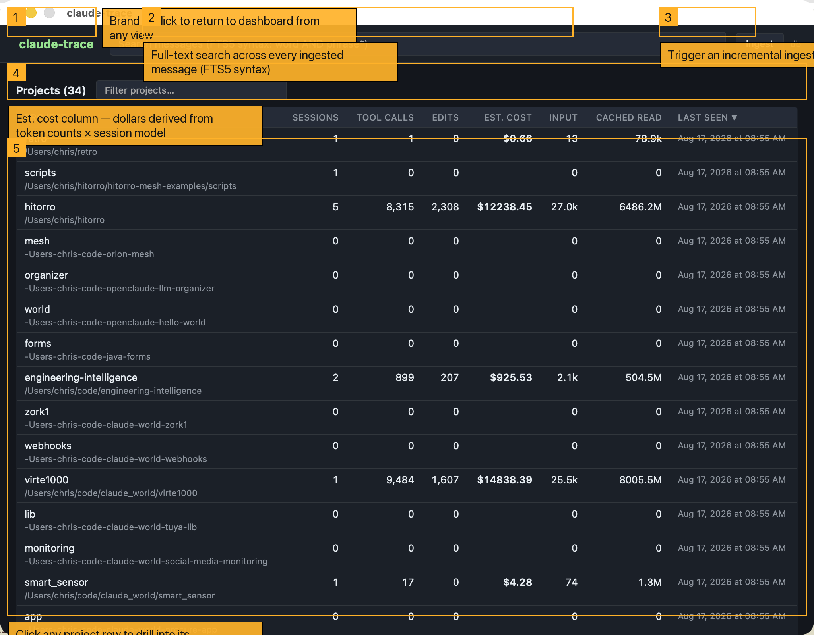
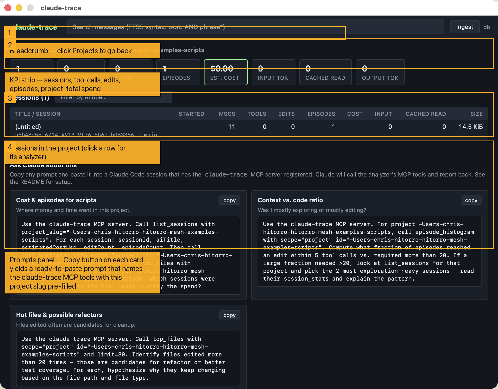

# claude-trace — Design, Build, and Usage Guide

`claude-trace` is a native desktop analyzer for Claude Code JSONL sessions.
It ingests every session file under `~/.claude/projects/*/*.jsonl` into a
local SQLite database, derives higher-level structures (episodes, tool
classifications, blast radius, cost) and exposes them through three
surfaces:

1. A **Wails desktop UI** (Go backend + React frontend, packaged as a
   native `.app` bundle).
2. A **REST API** (embedded in the app, or run headless via `ct serve`).
3. An **MCP server** (JSON-RPC 2.0 over stdio, so Claude Code itself can
   query the analyzer).

This document walks through the design choices, the data model, the
build/run procedure, and a screenshot-driven tour of the UI.

---

## Table of contents

1. [Why this tool exists](#why-this-tool-exists)
2. [Design principles](#design-principles)
3. [Architecture](#architecture)
4. [Data model](#data-model)
5. [Ingestion pipeline](#ingestion-pipeline)
6. [Episode segmentation](#episode-segmentation)
7. [Tool classification & Bash drill-in](#tool-classification--bash-drill-in)
8. [Cost estimation](#cost-estimation)
9. [Blast radius](#blast-radius)
10. [Intermediate artifact detection](#intermediate-artifact-detection)
11. [Watermarks](#watermarks)
12. [UI tour (with screenshots)](#ui-tour-with-screenshots)
13. [REST API](#rest-api)
14. [MCP server](#mcp-server)
15. [Prompts panel](#prompts-panel)
16. [Building & running](#building--running)
17. [Reproducing screenshots](#reproducing-screenshots)
18. [Repository layout](#repository-layout)

---

## Why this tool exists

Claude Code writes a rich JSONL transcript for every session, but out of
the box there is no way to answer the questions that actually matter
after the fact:

- **How much context did Claude build before it wrote code?** For each
  user prompt, how many `Read`/`Grep`/`Glob`/`Bash` calls fired before
  the first `Edit`/`Write`?
- **What did I actually spend?** In dollars, tokens, wall-clock time —
  per session, per project, per prompt.
- **Where did the bytes go?** Which files were read, which were edited,
  and which files reliably force a cascade of sibling edits ("blast
  radius")?
- **What was Bash doing?** A single `Bash` tool call can wrap anything
  from `ls` to `docker run` to a 30-line pipeline. What programs and
  actions dominated?
- **Did Claude build throwaway helpers?** Custom Python scripts written
  into `/tmp` are often a signal of an approach in trouble.

`claude-trace` derives every one of those signals from the transcripts
you already have on disk.

---

## Design principles

- **Zero-touch ingest.** Point at `~/.claude/projects` — no config, no
  labels. Every project and session is discovered.
- **Incremental.** Byte offsets are stored per file. Re-ingest reads
  only newly appended bytes.
- **Local-first.** SQLite on disk. No network calls. Cost estimation
  uses a bundled pricing table that can be overridden via
  `CT_PRICING=/path/to/pricing.json`.
- **CGO-free SQLite.** Uses `modernc.org/sqlite` so the binary builds
  cleanly on macOS/Linux/Windows without a C toolchain.
- **Three surfaces from one backend.** The Wails app, the CLI, and the
  MCP server all import the same `internal/store` package. There is one
  source of truth for every query.
- **Structured, not textual, analysis.** Everything the UI shows is
  computed by SQL from the ingested tables. No LLM in the hot path;
  the LLM only appears when you paste one of the copy-ready prompts
  from the [Prompts panel](#prompts-panel).

---

## Architecture

```
                    ┌────────────────────────────┐
                    │   ~/.claude/projects/**    │
                    │      *.jsonl transcripts   │
                    └────────────┬───────────────┘
                                 │  streaming decoder
                                 ▼
   ┌─────────────────────────────────────────────────────────┐
   │  internal/parser  →  internal/ingest  →  internal/store │
   │  (JSONL)             (walk + resume)     (SQLite + FTS5)│
   └───────────┬─────────────────┬─────────────────┬─────────┘
               │                 │                 │
               ▼                 ▼                 ▼
        internal/analyzer   internal/pricing   internal/api
        (episodes)          (cost estimation)  (REST)
               │                 │                 │
               └────────┬────────┴─────────────────┤
                        │                          │
              ┌─────────▼─────────┐       ┌────────▼────────┐
              │  Wails desktop UI │       │ MCP over stdio  │
              │ (React + Vite TS) │       │ (JSON-RPC 2.0)  │
              └───────────────────┘       └─────────────────┘
                        │                          │
                        └──────────┬───────────────┘
                                   ▼
                         `cmd/ct` — CLI entry
                (ingest / serve / mcp / rebuild-all / …)
```

`internal/store` is the single boundary through which every surface
touches data. The Wails app opens an in-process handle; `ct serve`
opens a handle behind an HTTP router; `ct mcp` opens one behind a
JSON-RPC dispatcher.

---

## Data model

Ten physical tables, plus one FTS5 virtual table.

| Table            | Purpose                                                                 |
|------------------|-------------------------------------------------------------------------|
| `projects`       | One row per `~/.claude/projects/<slug>` directory                       |
| `sessions`       | One per JSONL file (a Claude Code session UUID)                         |
| `files`          | Distinct absolute file paths ever touched                               |
| `messages`       | Every JSONL event — user / assistant / system / meta — with `raw_json`  |
| `tool_calls`     | Extracted `tool_use` blocks with classification + `file_path`           |
| `episodes`       | Segmented user turn → next `Edit`/`Write`                               |
| `watermarks`     | User-anchored annotations on a message ("at this point I was about to…")|
| `ingest_state`   | Byte offset per file for incremental resume                             |
| `session_totals` | Cached per-session aggregates (used by dashboards)                      |
| `file_stats`     | Cached per-file rollups (blast radius uses these)                       |
| `messages_fts`   | FTS5 index over message text, kept in sync with content triggers        |

Key derived fields on `tool_calls`:

- `is_modifying`, `is_read`, `is_bash`, `is_search`, `is_subagent` —
  boolean classifications derived at ingest time.
- `file_path` — primary path input (for `Edit`/`Write`/`Read`).
- `result_size` — length of the tool result, used to sum
  `bytesReadBeforeEdit`.
- `bash_program` + `bash_action` — set for `is_bash=true` rows by
  `internal/ingest/bashclass.go`.

Key derived fields on `episodes`:

- `tool_call_count` — tools before the first modifying tool.
- `bytes_read_before_edit` — sum of `result_size` for read/search calls
  before the first `Edit`/`Write`.
- `intermediate_artifact_count`, `intermediate_artifacts_json` — writes
  to `/tmp`, `/private/tmp`, `/var/tmp`, `/var/folders`.
- `duration_ms` — wall-clock from user turn to episode end.
- `cost_usd` — computed from token usage × session's dominant model rate.

---

## Ingestion pipeline

`internal/ingest/ingest.go` walks every subdirectory under
`~/.claude/projects` (override with `$CLAUDE_PROJECTS`). For each
`*.jsonl` file:

1. Read the persisted byte offset from `ingest_state`. If the file has
   grown, seek to that offset and stream only the new bytes.
2. Decode line-by-line using `internal/parser`. Each JSON line becomes
   one `messages` row plus zero or more `tool_calls` rows.
3. All writes happen inside a single transaction per file. To avoid the
   classic "held-tx + helper-connection deadlock" with modernc.org SQLite,
   the pool is sized to 8 (`db.SetMaxOpenConns(8)`) and any tx-time
   upserts go through `upsertSessionTx` / `upsertProjectTx` helpers so
   they stay on the transaction handle.
4. On success, `ingest_state` is updated with the new offset and the
   file's mtime. Interrupt safety: the offset only advances after the
   commit, so a crash means the next run re-processes the same bytes.
5. Aggregates are recomputed via `RecomputeSessionAggregates` and
   `RecomputeProjectAggregates`, which run pure SQL rollups against the
   base tables.

Numbers from a real ingest on the author's machine (August 2026):

- **29 JSONL files → 129,464 messages → 30,584 tool_calls → 2,047
  episodes in ~12.5 seconds.**
- Resulting DB: ~540 MB (dominated by `raw_json` payloads).
- Re-running immediately after: sub-second — nothing new to read.

---

## Episode segmentation

An **episode** is the unit of "one user turn until the next visible
change to source code." It starts with a `user` message and ends when
the assistant emits its first modifying tool call (`Edit`, `Write`,
`NotebookEdit`) — OR when the next `user` message arrives.

Segmentation lives in `internal/analyzer/episodes.go`. Two subtleties
worth calling out:

**1. Metrics stop at the first edit; membership does not.** An earlier
version of the analyzer flushed the episode object the moment it saw
the first `Edit`. Consequence: no episode ever had more than one
modifying tool call, and "avg sibling edits" for blast radius was
always 0. The current design keeps a boolean `editSeen` inside the
per-episode aggregator:

```go
// Metrics for "before edit" stop when editSeen=true; toolCallIDs keep
// growing until the next user turn, which makes blast-radius siblings
// queryable in SQL.
if tc.IsModifying {
    if !a.editSeen {
        a.editSeen = true
        a.firstEditTC = tc
        a.firstEditTCSet = true
    }
    return
}
if !a.editSeen {
    a.toolCallCount++
    if tc.IsRead || tc.IsSearch { a.bytesReadBeforeEdit += tc.ResultSize }
}
```

**2. Re-runnable.** `ct rebuild-all` (or the REST endpoint
`POST /api/v1/episodes/rebuild`) wipes and rebuilds the `episodes` table
from `tool_calls` alone. Adding a new metric only requires updating the
analyzer and rerunning this command — no JSONL re-read.

---

## Tool classification & Bash drill-in

Every `tool_use` block is stamped with a set of booleans at ingest time.
`Edit`/`Write`/`NotebookEdit` are modifying; `Read` is a read;
`Grep`/`Glob` are searches; `Task` is a subagent; `Bash` is bash. This
lets every SQL rollup treat "did code get written?" as `WHERE
is_modifying = 1` without string-matching tool names.

`Bash` calls are further classified in `internal/ingest/bashclass.go`.
The classifier walks past shell comments, environment-variable prefixes
(`FOO=1 bar`), sudo/env wrappers, and pipelines to find the real
program, then optionally extracts an action (`git commit`, `docker run`,
`npm install`). Care was taken to skip shell keywords — early versions
misclassified `for`, `until`, `#` as programs.

Live sample from the `hitorro/dag-pipeline-framework` session (2,165
edits, 30,892 messages, ~$11k spend):

```
program      action        count   errors
─────────────────────────────────────────────
grep                        2,448      15
cd                          2,030      30
curl                        1,662      34
sleep                         623      53
ls                            545      23
docker       run              424       9
tail                          314      11
cat                           289       5
bash                          274       6
echo                          267       4
git          add              230       5
rm                            228       8
```

This kind of breakdown answers questions a raw tool histogram cannot,
e.g. "how much of my Bash traffic is _actually_ Docker vs. how much is
`grep`ping?"

The **Bash** tab in the session view is powered by
`/api/v1/bash/breakdown` and `/api/v1/bash/samples` — click any row to
open a modal of concrete commands (with results) for that
`(program, action)` pair.

---

## Cost estimation

`internal/pricing/pricing.go` holds Anthropic list rates per model, with
four buckets: input, cache-creation, cache-read, output. The per-session
"dominant model" is the model producing the majority of the session's
output tokens; every episode in that session is costed at that model's
rate:

```
cost_usd_episode  =  input_tokens         * rate.Input
                  +  cache_creation_tokens * rate.CacheCreation
                  +  cache_read_tokens     * rate.CacheRead
                  +  output_tokens         * rate.Output
```

Session and project cards sum their child episodes. Override the pricing
table without recompiling by setting `CT_PRICING` to a JSON file with
the same shape as `pricing.Default`.

---

## Blast radius

The `Files` tab and the `/api/v1/files/blast-radius` endpoint present
every file the current scope touched, with these columns:

| Column           | Meaning                                                          |
|------------------|------------------------------------------------------------------|
| `readCount`      | Reads inside this scope                                          |
| `editCount`      | Edits inside this scope                                          |
| `episodes`       | Distinct episodes that touched the file                          |
| `sessions*`      | Distinct sessions across **all** ingested history                |
| `projects*`      | Distinct projects across **all** ingested history                |
| `avgSiblingEdits`| Mean # of other files edited in the same episodes as this file   |

The `*` counts are deliberately whole-DB, not scope-limited — the
question they answer is "how central is this file across everything I
work on."

Live sample from the same `hitorro` session (top 6 by
`readCount + editCount`):

```
filePath                                                          R    E   eps  avgSib
──────────────────────────────────────────────────────────────────────────────────────
/Users/chris/code/claude_world/virte1000/src/device.c            131  319   66   1.6
/Users/chris/code/claude_world/virtio_net/src/device.c           117  130   59   0.8
/Users/chris/code/claude_world/rtl8139_re/src/device.c            45  156   48   1.1
/Users/chris/code/claude_world/python-amigaos4/_amigamodule.c     64  110   30   2.2
…/hitorro-mesh-driver-app/src/main/resources/static/ui/app.js     52  100   40   7.3
…/hitorro-mesh-driver/…/QueryDispatcher.java                      43   62   22   6.9
```

`app.js` and `QueryDispatcher.java` both have `avgSiblingEdits ≈ 7` —
touching either one usually pulled seven other files along in the same
episode. That is the "cascade" the blast radius metric is designed to
surface: they're strong refactor / abstraction candidates.

---

## Intermediate artifact detection

Writes to `/tmp`, `/private/tmp`, `/var/tmp`, or `/var/folders` are
flagged as _intermediate artifacts_ on the enclosing episode.
Rationale: when Claude writes a helper script mid-session it's usually
because a canonical tool wasn't available or a canned approach isn't
working. Counting these per episode gives a cheap indicator of "Claude
built a throwaway to answer this prompt."

An earlier heuristic also flagged writes outside the CWD — but that
produced too many false positives for repos with sibling subprojects
(you'd get flagged for editing `../mesh-app/src/*` from
`./mesh-driver/`). The current, tighter rule is: **only paths whose
parent is one of the four temp directories above.**

---

## Watermarks

A watermark is a user-authored annotation attached to a specific
`message.uuid`. Watermarks let you slice a session by "before / after
the moment I asked X." The timeline tab exposes an inline `+ mark`
button next to every message; the resulting `watermarks` row records
the message UUID, a short label, and an optional note.

`SessionEpisodeStats` and the corresponding REST endpoint bucket
episodes by watermark, so you can compare "tool calls before I asked
for the refactor" vs "tool calls after" without leaving the app.

---

## UI tour (with screenshots)

The UI is a React + Vite + TypeScript SPA rendered inside a Wails
window. There are five views, chained by a simple stack navigator
(`Escape` walks back one level).

### Dashboard

The first view. Shows every ingested project sorted by last-seen, with
per-project counters (sessions, tool calls, edits) plus an **Est. cost**
column derived from the sum of per-session cost estimates.



Callouts:

1. **Brand** — click at any time to return to the dashboard.
2. **Search bar** — FTS5 across every ingested message. Supports raw
   FTS5 syntax (`iterator AND refactor`, `"exact phrase"`, `foo NEAR
   bar`).
3. **Ingest button** — kicks off an incremental ingest. Progress is
   surfaced inline; the button is disabled while a run is in flight.
4. **Filter bar** — client-side name filter over the project list.
5. **Est. cost column** — session-level cost estimates summed per
   project. This is the top-level "where is the money going" signal.

### Project

Click a project row. You get a strip of KPIs (session count, message
count, edit count, cost, cache hit ratio) plus the list of sessions in
that project.



Callouts:

1. **Breadcrumb** — `Dashboard / <project>` navigation.
2. **KPI strip** — the numbers you need to reason about the whole
   project without opening a session.
3. **Sessions table** — sortable, one row per JSONL file.
4. **Prompts panel** — pre-built copy-ready prompts scoped to _this
   project_. See [Prompts panel](#prompts-panel) below.

### Session

Click a session row. Session view has a breadcrumb, top-line KPIs, and
seven tabs:

| Tab          | Contents                                                                |
|--------------|-------------------------------------------------------------------------|
| **Episodes** | List of episodes with `toolCallCount`, `bytesReadBeforeEdit`, `costUsd`, `editFilePath`. Sortable, clickable. |
| **Tools**    | Per-tool histogram (count, errors, total result bytes) + top files touched. |
| **Bash**     | `(program, action)` breakdown; click a row to open a modal of concrete commands with results. |
| **Files**    | Every file the session touched, with blast-radius columns.              |
| **Stats**    | Episode-count histogram (buckets by tool_call_count). Split around any active watermark. |
| **Timeline** | Paginated raw messages (300/page) with a `+ mark` action per row.       |
| **Watermarks** | List of user-defined watermarks + delete/edit.                        |

Sample of the **Episodes** tab, rendered against the real `hitorro`
session:

```
ep#     tc  bytesRead  intArt   costUsd  →  editFilePath
──────────────────────────────────────────────────────────────────────────────────
8190     7          0       0  $ 2.229  →  (no edit — clarification turn)
8191    17          0       0  $18.792  →  (no edit — plan/discussion)
8192     8      3,189       0  $ 3.950  →  (no edit — "start executing")
8193     8     32,217       0  $19.989  →  …/hitorro-streams/pom.xml
8194     3          0       1  $55.418  →  …/hitorro-primitives/pom.xml
8195    19     22,590       0  $53.509  →  …/AbstractIteratorFactory.java
```

Two things jump out in seconds: episode 8194 was a _tiny_ 3-tool-call
turn that still cost $55 (long context + big output), and it produced
one intermediate artifact — worth clicking through to see what.

Sample of the **Tools** tab for that same session:

```
tool             count   modifying   errors    resultBytes
──────────────────────────────────────────────────────────
Bash             3,540           0       45     2,641,098
Edit             1,538       1,538      121       296,235
Read               685           0        1     1,575,486
TaskUpdate         684           0        2        17,894
Write              627         627        3       120,256
TaskCreate         374           0        1             …
```

The Bash column here is why the **Bash** tab exists — see
[Tool classification & Bash drill-in](#tool-classification--bash-drill-in)
for the drill-down.

Sample of the **Files** tab (top 6 by activity, real data), see
[Blast radius](#blast-radius) above for column definitions.

### Episode

Click an episode row. You get the full tool-call sequence, the
user prompt excerpt, the eventual edit target, cost, tokens, and a
"View raw JSON" drill-in per message.

The `PromptsPanel` here contains **episode-scoped** prompts: "Explain
this episode", "Efficiency review", "Cost drivers".

### Search

The magnifying-glass affordance in the header runs an FTS5 query and
opens a results view with snippets and a link back to the enclosing
message/session.

---

## REST API

Base path: `/api/v1`. Every JSON endpoint accepts a
`?scope=session|project|global` param plus an `id=…` where relevant. The
port is chosen automatically by the OS and exposed:

- In the Wails app: shown in the session breadcrumb, and available
  programmatically via `GetAppInfo`.
- As a headless daemon: `ct serve --addr 127.0.0.1:8787`.

Full endpoint table:

| Method | Path                                             | Description                        |
|--------|--------------------------------------------------|------------------------------------|
| GET    | `/healthz`                                       | Health check                       |
| GET    | `/projects`                                      | All projects                       |
| GET    | `/projects/:slug/sessions`                       | Sessions in a project              |
| GET    | `/sessions/:id`                                  | Session summary                    |
| GET    | `/sessions/:id/episodes`                         | Episodes                           |
| GET    | `/sessions/:id/stats`                            | Bucketed episode stats             |
| GET    | `/sessions/:id/messages?limit=&offset=`          | Paginated messages                 |
| GET    | `/sessions/:id/tool-calls`                       | All tool calls in the session      |
| GET    | `/sessions/:id/watermarks`                       | List watermarks                    |
| POST   | `/sessions/:id/watermarks`                       | Add `{messageUuid,label,note}`     |
| DELETE | `/watermarks/:id`                                | Delete a watermark                 |
| GET    | `/episodes/:id`                                  | Single episode                     |
| GET    | `/episodes/:id/tool-calls`                       | Tool calls for episode             |
| POST   | `/episodes/rebuild`                              | `{sessionId}` → re-analyze         |
| GET    | `/episodes/histogram?scope=`                     | Episode bucket distribution        |
| GET    | `/tools/histogram?session=|project=|global=1`    | Tool usage counts                  |
| GET    | `/files/top?scope=&limit=`                       | Most-touched files                 |
| GET    | `/files/blast-radius?scope=&id=&limit=`          | Blast-radius per file              |
| GET    | `/bash/breakdown?scope=&id=`                     | `(program, action)` counts         |
| GET    | `/bash/samples?scope=&id=&program=&action=&limit=` | Concrete Bash invocations        |
| GET    | `/search?q=&limit=`                              | FTS5 search                        |
| GET    | `/messages/:id/raw`                              | Raw JSON of one message            |
| POST   | `/ingest`                                        | Run ingestion (blocking)           |
| GET    | `/export/episodes.csv?session=`                  | CSV export                         |
| GET    | `/export/tool-calls.csv?session=`                | CSV export                         |

Quick examples:

```bash
curl http://127.0.0.1:8787/api/v1/projects
curl 'http://127.0.0.1:8787/api/v1/tools/histogram?project=-Users-chris-hitorro'
curl 'http://127.0.0.1:8787/api/v1/search?q=iterator+AND+refactor&limit=20'
curl 'http://127.0.0.1:8787/api/v1/bash/breakdown?scope=session&id=<uuid>'
curl 'http://127.0.0.1:8787/api/v1/files/blast-radius?scope=session&id=<uuid>&limit=25'
```

---

## MCP server

`ct mcp` speaks JSON-RPC 2.0 over stdio, newline-delimited. The 15
exposed tools mirror the REST endpoints:

`list_projects`, `list_sessions`, `get_session`, `list_episodes`,
`get_episode`, `session_stats`, `tool_histogram`, `top_files`,
`episode_histogram`, `search_messages`, `bash_breakdown`,
`bash_samples`, `files_blast_radius`, `add_watermark`, `ingest`.

Register with Claude Code by adding to `~/.claude/settings.json`:

```json
{
  "mcpServers": {
    "claude-trace": {
      "command": "/absolute/path/to/ct",
      "args": ["mcp"]
    }
  }
}
```

Or override the DB location:

```json
{
  "mcpServers": {
    "claude-trace": {
      "command": "/absolute/path/to/ct",
      "args": ["mcp"],
      "env": { "CT_DB": "/absolute/path/to/claude_trace.db" }
    }
  }
}
```

Restart Claude Code. Its MCP client will discover the tools
automatically. Quick smoke test without a client:

```bash
printf '%s\n' \
  '{"jsonrpc":"2.0","id":1,"method":"initialize","params":{}}' \
  '{"jsonrpc":"2.0","id":2,"method":"tools/list","params":{}}' \
  '{"jsonrpc":"2.0","id":3,"method":"tools/call","params":{"name":"list_projects","arguments":{}}}' \
  | ct mcp
```

---

## Prompts panel

Every UI view has an **Ask Claude about this** panel with copy-ready
prompts. Each prompt is written to _invoke the `claude-trace` MCP
tools_ with the IDs of the current view. If you haven't wired MCP up
yet, the prompts still describe the analysis you want Claude to do.

Categories:

- **Dashboard** — global cost roll-up, global tool usage, global
  episode-depth distribution.
- **Project** — cost & episodes for this project, context-vs-code
  ratio, hot-files & refactor candidates.
- **Session** — full analysis, exploration-heavy episodes,
  cost/time correlation, between-prompts processing, intermediate
  tools built, what Bash was doing, blast radius.
- **Episode** — play-by-play, efficiency review, cost drivers.

The panel is generated by `frontend/src/components/PromptsPanel.tsx`;
adding new prompts is a matter of editing `buildPrompts(ctx)`.

---

## Building & running

Requirements:

- Go 1.25+
- Node 20+ / npm (Vite build)
- Wails CLI (`go install github.com/wailsapp/wails/v2/cmd/wails@latest`)
- macOS (developed on Darwin 25.5). Linux/Windows should work via the
  same Wails toolchain but haven't been tested by the author.

### Build everything (recommended first run)

```bash
# from repo root
go install ./cmd/ct               # installs the `ct` CLI
ct ingest                         # first-time ingest of ~/.claude/projects
wails build                       # produces build/bin/claude-trace.app
open build/bin/claude-trace.app
```

### Developer loop

```bash
wails dev                         # hot-reload Wails + Vite
```

### Headless services

```bash
ct serve --addr 127.0.0.1:8787    # REST only
ct mcp                            # MCP server on stdio
```

### CLI subcommands

```
ct ingest              # incremental ingest
ct projects            # list ingested projects
ct sessions <slug>     # list sessions in a project
ct episodes <sid>      # list episodes in a session
ct serve --addr …      # run REST server
ct mcp                 # run MCP server on stdio
ct rebuild-all         # re-run analyzer over every session
ct backfill-bash       # re-classify Bash calls with the latest rules
```

### Config

| Env var        | Purpose                                                      | Default                     |
|----------------|--------------------------------------------------------------|-----------------------------|
| `CT_DB`        | SQLite path                                                  | `~/.claude/claude_trace.db` |
| `CT_PRICING`   | JSON file overriding model rates                             | bundled table               |
| `CLAUDE_PROJECTS` | Override the scan root                                    | `~/.claude/projects`        |

---

## Reproducing screenshots

The two annotated screenshots in `docs/screenshots/` were produced by a
helper script at `/tmp/ct-shot.py` (not shipped with the repo — it's a
one-off).

To capture your own shots of any view:

1. Launch the app: `open build/bin/claude-trace.app`.
2. Focus the window; navigate to the view you want.
3. Get the window bounds and capture:

   ```bash
   osascript -e 'tell application "System Events" to tell process "claude_trace" to \
       get {position of window 1, size of window 1}'
   # → e.g. {{80, 60}, {1400, 900}}
   screencapture -x -o -R 80,60,1400,900 shot.png
   ```

To _annotate_ a shot (draw numbered gold callouts on regions), install
Pillow (`pip install Pillow`) and use `PIL.ImageDraw` to overlay
rectangles + text; the source for the exact style used in
`01-dashboard.png` / `02-project.png` is in `/tmp/ct-shot.py`.

Session tab screenshots (Episodes / Tools / Bash / Files / Timeline)
are intentionally left to the reader — they need the app to be in the
correct state (opened session, correct tab selected), which is hard to
automate reliably from AppleScript because the tabs are React
components with no accessible role. Manual capture takes seconds.

---

## Repository layout

```
claude_trace/
├── main.go                       Wails entry point
├── app.go                        Wails bindings + embedded REST server
├── wails.json                    Wails project config
├── go.mod / go.sum
├── cmd/
│   └── ct/                       CLI subcommands (ingest / serve / mcp / …)
├── internal/
│   ├── parser/                   JSONL streaming decoder + types
│   ├── store/                    SQLite schema, migrations, queries, FTS5
│   ├── ingest/                   Walk + parse + write + Bash classifier
│   ├── analyzer/                 Episode segmentation
│   ├── pricing/                  Model rate tables + cost estimation
│   ├── api/                      REST server
│   └── mcp/                      JSON-RPC 2.0 over stdio
├── frontend/
│   ├── src/
│   │   ├── App.tsx               Stack navigator
│   │   ├── nav.ts                Discriminated-union nav state
│   │   ├── format.ts             fmtInt / fmtTokens / fmtDuration / …
│   │   ├── components/           HeaderBar, PromptsPanel, ...
│   │   └── views/                Dashboard / Project / Session / Episode / Search
│   ├── package.json
│   └── vite.config.ts
├── docs/
│   └── screenshots/              Annotated PNGs (embedded above)
├── README.md                     Quick-start & user-facing overview
└── DESIGN.md                     This file
```

Default DB location: `~/.claude/claude_trace.db`. Override with
`CT_DB=/some/path.db`.

---

## Roadmap ideas (not implemented)

- Time-of-day heatmap per project.
- Prompt-similarity clustering to spot repeated questions.
- Live tailing of an in-progress JSONL file.
- A Grafana-style dashboard export.
- Auth layer for the REST endpoint (currently loopback-only, no auth).
- Windows / Linux packaging verification.

Contributions welcome — the store is the source of truth, so any new
insight can usually be added as one SQL query + one REST endpoint + one
React view.
